# Manual de usuario: Sigmalena

**Sigmalena** (sigma + Magdalena) es una aplicación de control estadístico de procesos (CEP) que se usa en el navegador. Versión de la API 0.1.0. Usa la paleta de la Universidad del Magdalena (azul `#004A87` y complemento naranja `#FF9400`).

> Sigmalena está publicada en <https://cep-web.vercel.app>. También puede usarse en local (sección 3).

## Tabla de contenido

1. Objetivo del programa
2. Público objetivo
3. Requerimientos e instalación
4. Estructura de módulos
5. Paso a paso de cada función
6. Formato de entrada de datos
7. Interpretación de las salidas
8. Ejemplos de uso con los archivos de `data/ejemplos/`
9. Errores frecuentes y su solución
10. Glosario técnico
11. Contacto del equipo

Todos los ejemplos de este manual usan **datos sintéticos** (llenado de envases de 500 g con especificaciones LIE 495 g y LSE 505 g). No describen ningún proceso real. Las cifras citadas salen de las respuestas guardadas en `docs/informe/anexos/salidas/`.

---

## 1. Objetivo del programa

El programa ayuda a decidir si un proceso de producción es estable, si cumple sus especificaciones y cuánta inspección hace falta para vigilarlo. Con él se puede:

- Cargar datos de Excel o CSV, o escribirlos o pegarlos desde una hoja de cálculo en una tabla de la propia página, formar subgrupos racionales y limpiar los datos con registro de cada decisión.
- Construir gráficos de control por variables (X-barra y R, X-barra y S, individuales y rango móvil) y por atributos (p, np, c, u), separando la **Fase I** (estimar y congelar límites) de la **Fase II** (monitorear contra límites congelados).
- Validar normalidad e independencia de los datos.
- Calcular Cp, Cpk, Cpl, Cpu, Pp, Ppk, Cpm y la fracción no conforme esperada y observada.
- Diseñar gráficos con ARL0, ARL1 y ATS y comparar tamaños de muestra y frecuencias de muestreo.
- Diseñar y evaluar planes de muestreo de aceptación simples y dobles.
- Guardar los análisis y generar un reporte para imprimir o exportar a Excel.

## 2. Público objetivo

| Quién | Qué hace con el programa |
|---|---|
| Ingeniero de proceso o de calidad | Carga datos, construye gráficos, valida supuestos y calcula capacidad |
| Jefe de producción | Lee el resumen del gráfico y las advertencias para decidir si intervenir |
| Responsable de metrología o de inspección | Define cuántas muestras tomar y cada cuánto con el módulo de diseño |
| Estudiante o docente de control estadístico de procesos | Explora los conceptos con los archivos sintéticos |

Se supone conocimiento básico de qué es un subgrupo, un límite de control y una especificación. El glosario (sección 10) define los términos.

## 3. Requerimientos e instalación

### Para quien solo usa el programa ya desplegado

Un navegador actual (Chrome, Edge, Firefox o Safari) y una cuenta (o entrar como invitado, sección 5.1). No hay que instalar nada. El archivo de datos debe pesar como máximo 4 MB y tener hasta 20 000 filas.

> El programa se abre en <https://cep-web.vercel.app>.

### Para ejecutarlo en un equipo propio

| Herramienta | Versión |
|---|---|
| Python | 3.12 |
| uv | reciente |
| Node.js | 20 o superior |

La ruta del proyecto tiene un espacio (`control v2`): escribirla entre comillas.

```bash
cd "control v2"

# Terminal 1: motor de cálculo (API)
cd api
uv venv --python 3.12 .venv
uv pip install -r requirements-dev.txt
AUTH_DISABLED=1 .venv/bin/uvicorn main:app --port 8000

# Terminal 2: interfaz web
cd web
cp .env.example .env.local
npm install
npm run dev
```

Abrir `http://localhost:3000`. En `web/.env.local` hay dos formas de trabajar:

- **Modo de demostración:** poner `NEXT_PUBLIC_DEMO_MODE=1`. No hace falta base de datos; las cuentas y los datos viven solo en el navegador. La pantalla de acceso ofrece una cuenta de ejemplo con estudios sintéticos y también el acceso como invitado, que en este modo queda guardado solo en ese navegador.
- **Modo real:** poner `NEXT_PUBLIC_SUPABASE_URL` y `NEXT_PUBLIC_SUPABASE_ANON_KEY` de un proyecto de Supabase. Los datos se guardan en la base de datos y cada usuario ve solo lo suyo.

Después de cambiar `.env.local` hay que reiniciar `npm run dev`. Las instrucciones de despliegue en Vercel están en `docs/despliegue.md`.

## 4. Estructura de módulos

Tras iniciar sesión se llega a la lista de **Estudios**. Un estudio es un proceso con una característica de calidad. Dentro de un estudio, la barra de navegación muestra las pestañas siguientes (las de atributos son distintas de las de variables):

| Pestaña | Módulo del enunciado | Estudios por variables | Estudios por atributos |
|---|---|---|---|
| Resumen | (panorama y flujo de trabajo) | sí | sí |
| Datos | 1. Gestión de datos | sí | sí |
| Variables | 2. Gráficos por variables | sí | no |
| Atributos | 3. Gráficos por atributos | no | sí |
| Supuestos | 4. Validación de supuestos | sí | no |
| Capacidad | 5. Capacidad del proceso | sí | no |
| Diseño | 6. Diseño de gráficos (ARL, ATS) | sí | sí |
| Muestreo | 7. Muestreo de aceptación | sí | sí |
| Reporte | 8. Reportes | sí | sí |

Orden de trabajo recomendado en un estudio por variables:

1. Crear el estudio con sus especificaciones.
2. Cargar un conjunto de datos y guardarlo como **Fase I**.
3. En **Variables**, depurar la Fase I y **congelar los límites**.
4. En **Supuestos**, comprobar normalidad e independencia.
5. En **Capacidad**, calcular los índices.
6. Guardar un conjunto de datos nuevo como **Fase II** y monitorearlo en **Variables**.
7. En **Diseño** y **Muestreo**, decidir el esquema de inspección.
8. En **Reporte**, reunir y exportar.

## 5. Paso a paso de cada función

Las capturas están en `docs/capturas/`. Si una imagen no se ve al leer este archivo fuera del repositorio, copiar la carpeta `capturas/` junto al manual.

### 5.1 Acceso

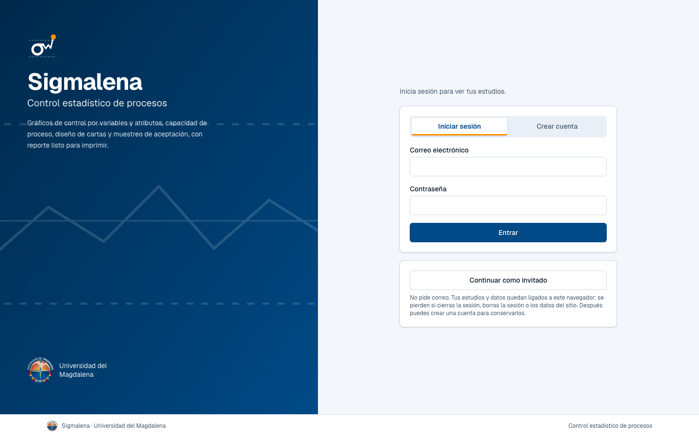

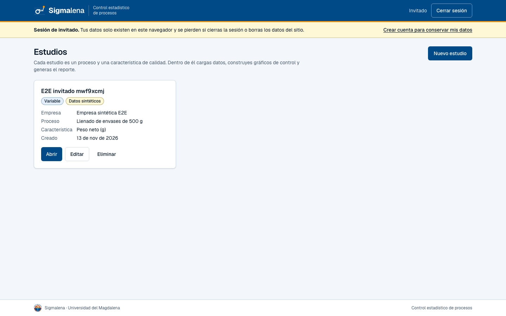

**Con cuenta.**

1. Abrir la dirección del programa.
2. En la pestaña **Iniciar sesión** escribir el correo y la contraseña, y pulsar **Entrar**.
3. Para una cuenta nueva, elegir la pestaña **Crear cuenta** (la contraseña lleva mínimo 6 caracteres) y pulsar **Crear cuenta**.
4. En modo de demostración aparece el recuadro «Modo de demostración» con el botón **Entrar con la cuenta de demostración**.
5. Para salir, pulsar **Cerrar sesión** en la barra superior.

**Como invitado (sin registrarse).** Debajo del formulario hay un recuadro con el botón **Continuar como invitado**. No pide correo ni contraseña: se abre una sesión anónima y se llega a la lista de Estudios. Sirve para probar el programa. Lo que hay que saber:

- La barra superior muestra «Invitado» en lugar del correo, y debajo aparece de forma permanente el aviso **«Sesión de invitado. Tus datos solo existen en este navegador y se pierden si cierras la sesión o borras los datos del sitio.»**
- Un invitado tiene las mismas funciones que un usuario con cuenta y sus estudios son tan privados como los de cualquiera: ningún otro usuario puede verlos.
- Sus estudios quedan ligados a ese navegador. Si se borran los datos del sitio, se cambia de navegador o de equipo, o se cierra la sesión, **no hay forma de volver a entrar** en la sesión de invitado.

**Convertir al invitado en cuenta.** Para conservar los datos:

1. Pulsar **Crear cuenta para conservar mis datos** en el aviso.
2. Escribir un correo electrónico válido y una contraseña de al menos 6 caracteres, y pulsar **Crear cuenta**.
3. Los estudios y conjuntos de datos que ya existían pasan a la cuenta nueva; no hay que cargarlos otra vez. Desde entonces el aviso desaparece y la barra muestra el correo.
4. Si el sistema pide confirmar el correo, aparece «Revisa tu correo». Hasta abrir el enlace de confirmación se sigue como invitado y los estudios no se pierden ni cambian.

**Salir como invitado.** Al pulsar **Cerrar sesión** siendo invitado, el programa abre la ventana «¿Cerrar la sesión de invitado?», que advierte que se perderá el acceso a los estudios y conjuntos de datos porque un invitado no puede volver a entrar. Hay dos salidas: **Cerrar sesión y perder mis datos** (confirma) o **Cancelar** y usar antes «Crear cuenta para conservar mis datos».

Si aparece «Falta configurar el acceso», el equipo no tiene las variables de Supabase ni el modo de demostración (sección 3). Si al pulsar **Continuar como invitado** aparece un error, es probable que el proyecto de Supabase no tenga habilitados los inicios de sesión anónimos (ver sección 9).

### 5.2 Estudios

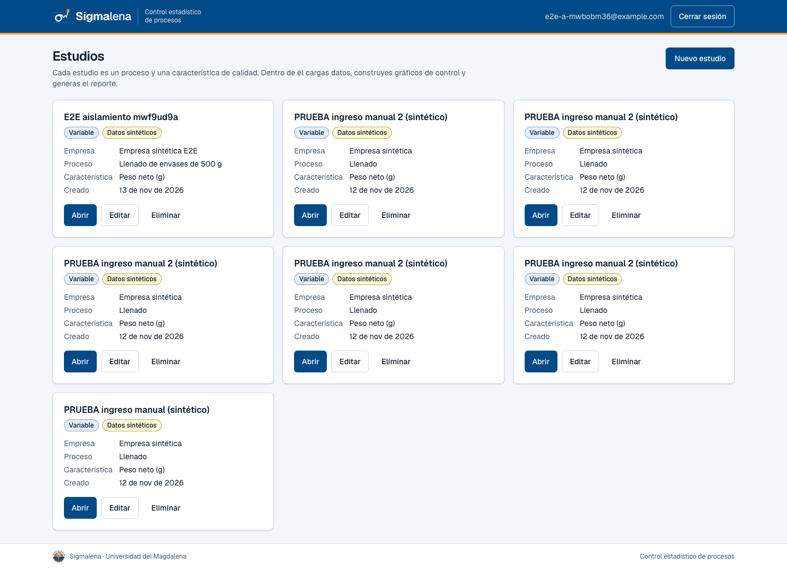

La lista muestra una tarjeta por estudio con tres acciones: **Abrir**, **Editar** y **Eliminar** (pide confirmación). El botón **Nuevo estudio** abre el formulario.

Al pulsar **Nuevo estudio** se abre un formulario con estos campos:

| Campo | Uso |
|---|---|
| Nombre del estudio (obligatorio) | Identifica el estudio en la lista |
| Empresa, Proceso, Producto | Contexto que se imprime en el reporte |
| Característica de calidad y Unidad de medida | Por ejemplo «Peso neto» y «g» |
| Tipo de dato | **Variable (medición continua)** o **Atributo (conteo)**; decide qué pestañas aparecen |
| LSL, USL y Objetivo | Límite inferior y superior de especificación y valor nominal; solo en estudios por variables. El USL debe ser mayor que el LSL y el objetivo debe quedar entre ambos |
| Notas | Texto libre |
| Datos sintéticos | Marcar si los datos son de ejemplo; el resumen del estudio muestra un aviso |

Pulsar **Crear estudio**. **Editar estudio** permite cambiar todo, incluidas las especificaciones.

La pestaña **Resumen** muestra los datos del estudio, un contador de conjuntos de Fase I y Fase II, límites congelados y análisis guardados, y el flujo de trabajo con un enlace por módulo.

### 5.3 Módulo 1: Datos

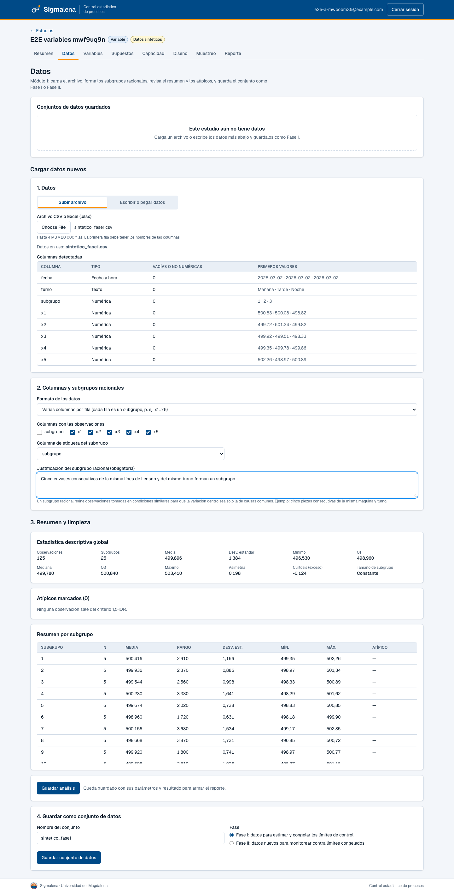

En la pestaña **Datos** se ve la lista de conjuntos guardados (nombre, fase, número de subgrupos, tamaño, archivo y fecha) con las acciones **Ver resumen** y **Eliminar**. Debajo está **Cargar datos nuevos**, que se hace en cuatro pasos. El primer paso ofrece dos pestañas: **Subir archivo** (CSV o Excel) y **Escribir o pegar datos** (tabla en la página, sección 5.3.1). Los pasos 2 a 4 son idénticos con cualquiera de las dos.

**Paso 1. Archivo.**
1. En la pestaña **Subir archivo**, pulsar el selector «Archivo CSV o Excel (.xlsx)» y elegir el archivo (máximo 4 MB y 20 000 filas; la primera fila debe tener los nombres de columna).
2. El programa lo lee y muestra «Columnas detectadas»: tipo (Numérica, Texto, Fecha y hora, Vacía), cuántas celdas están vacías o no son numéricas y los primeros valores.
3. Si el libro de Excel tiene varias hojas, aparece el selector **Hoja**.
4. Si la lectura tuvo que corregir algo, aparece el recuadro amarillo **Avisos al leer el archivo (n)** con una línea por conversión: fechas escritas día/mes/año que se pasaron a `AAAA-MM-DD`, textos con espacios recortados, celdas vacías o textos no numéricos (como `N/D`) registrados como faltantes y valores con coma decimal convertidos a punto. Estos avisos **no se pierden**: al guardar el conjunto pasan a la bitácora de limpieza. Con un archivo limpio, como `sintetico_fase1.csv` en la captura anterior, el recuadro no aparece.

**Paso 2. Columnas y subgrupos racionales (variables).**

| Control | Qué hace |
|---|---|
| Formato de los datos | **Una columna con los valores**, con varias filas por subgrupo; o **Varias columnas por fila**, donde cada fila es un subgrupo (x1 a x5) |
| Columnas con las observaciones | (formato de varias columnas) casillas para marcar x1, x2, etc. |
| Columna de etiqueta del subgrupo | Nombre con el que se rotula cada subgrupo |
| Columna del valor medido | (formato de una columna) la columna con los valores |
| Cómo se forman los subgrupos | **Por columna** (un identificador por subgrupo), **Por tamaño fijo** (cada n observaciones seguidas; n = 1 para individuales) o **Por tiempo** (hora, día, semana o mes) |
| Justificación del subgrupo racional | **Obligatoria**, mínimo 10 caracteres. Explicar por qué esas observaciones forman un subgrupo; ejemplo: «cinco envases consecutivos de la misma línea y turno» |

En atributos el paso 2 pide: **Qué cuentas** (unidades defectuosas o defectos), **Columna del conteo**, **Columna del tamaño de muestra** (o un **Tamaño constante** si no hay columna) y una **Columna de etiqueta**.

Si al formar los subgrupos hay problemas (celdas vacías, subgrupos de tamaños distintos), aparece el recuadro **Avisos al formar los subgrupos**, por ejemplo «3 celda(s) vacías o no numéricas se omitieron».

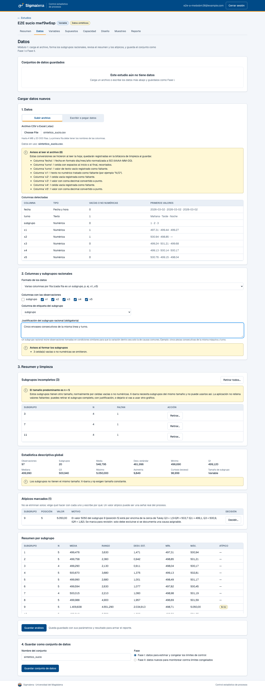

La captura muestra `sintetico_sucio.csv`: 97 observaciones en 20 subgrupos, el aviso sobre las celdas omitidas, el mensaje «Los subgrupos no tienen el mismo tamaño: X-barra y np exigen tamaño constante» y el valor 5050 en la tabla de atípicos.

**Paso 3. Resumen y limpieza.**

En la parte inferior de la primera captura se ven estas tablas. Se muestra la estadística descriptiva global (media, desviación, mínimo, cuartiles, mediana, máximo, asimetría y curtosis), una tabla por subgrupo (n, media, rango, desviación, mínimo y máximo) y la tabla **Atípicos marcados**. Un atípico es una observación fuera de los límites de Tukey (1,5 veces el rango intercuartílico). **El programa nunca los elimina solo.** Para cada uno, pulsar **Decidir…** y elegir:

- **Conservarlo:** es variación real del proceso y debe verse en los gráficos.
- **Retirar el subgrupo completo:** hay un error de medición o captura comprobado.

En ambos casos hay que escribir la **justificación**, y pulsar **Registrar decisión**. Queda en la bitácora de limpieza.

**Retirar subgrupos incompletos.** Si el conjunto tiene subgrupos con un tamaño distinto del predominante (normalmente por celdas vacías), aparece la tarjeta **Subgrupos incompletos (n)** con el aviso «El tamaño predominante es n = 5». Lista cada subgrupo con su tamaño y cuántas observaciones faltan. X-barra necesita subgrupos del mismo tamaño y no puede usarlos así. **El programa no rellena valores faltantes**, porque inventar datos distorsiona los límites. Hay tres salidas:

1. Pulsar **Retirar…** en la fila de un subgrupo, o **Retirar todos…** arriba a la derecha.
2. En la ventana «Retirar subgrupos incompletos», escribir la **justificación** (obligatoria, al menos 5 caracteres) y pulsar **Retirar y registrar**. Los demás subgrupos no cambian.
3. O dejarlos y usar un gráfico que admita tamaños distintos (por ejemplo, completar los datos en el archivo original).

Cada retiro aparece en la tarjeta **Bitácora de limpieza (de esta carga)** como «Subgrupo incompleto retirado», con su justificación.

**Paso 4. Guardar como conjunto de datos.**
1. Escribir el **Nombre del conjunto** (por defecto, el del archivo).
2. Elegir la **Fase**: **Fase I** (datos para estimar y congelar límites) o **Fase II** (datos nuevos para monitorear).
3. Pulsar **Guardar conjunto de datos**. Se necesitan al menos 2 subgrupos y la justificación escrita. Al guardar, la bitácora de limpieza incluye los avisos de la lectura del archivo, las decisiones sobre atípicos y los subgrupos retirados.

Al guardar aparece un enlace a los gráficos de control. En **Ver resumen** de un conjunto guardado se consultan la justificación del subgrupo, la bitácora de limpieza y los resúmenes.

#### 5.3.1 Ingreso manual: escribir o pegar datos

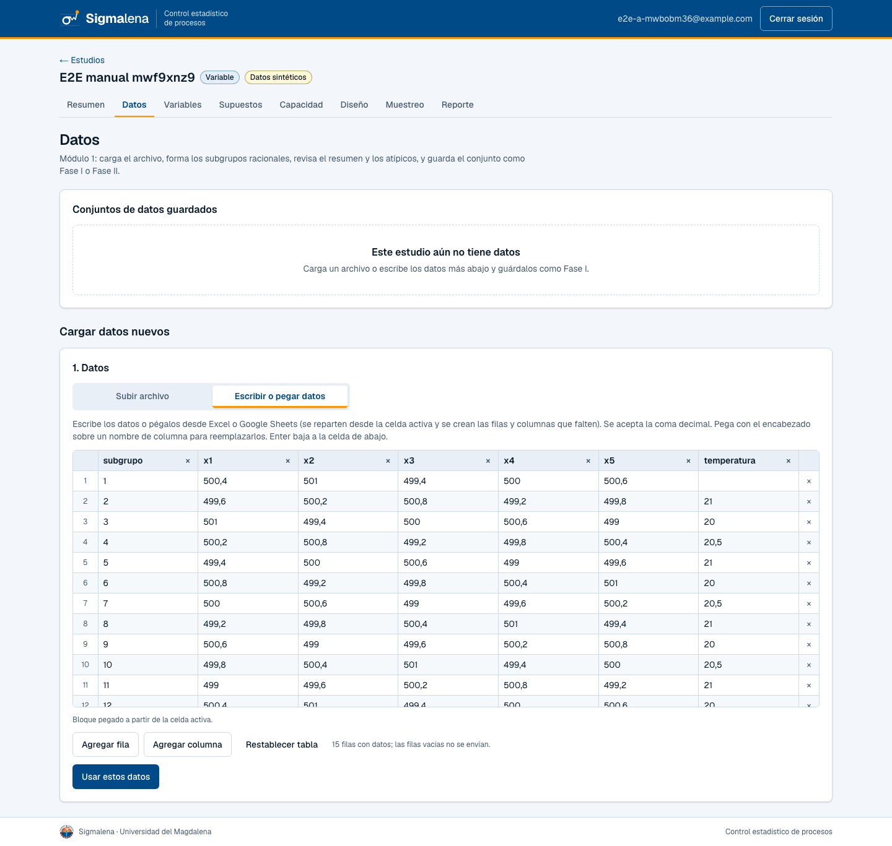

Para pocos datos, o cuando se tienen en una hoja de cálculo y no se quiere guardar un archivo, se pueden ingresar en la propia página.

1. En **Datos**, abrir la pestaña **Escribir o pegar datos**. Aparece una tabla con 10 filas vacías. En un estudio por variables las columnas iniciales se llaman `subgrupo`, `x1`, `x2`, `x3`, `x4` y `x5`; en uno por atributos, `muestra`, `inspeccionados` y `defectuosos`. Esos nombres los reconoce el mapeo automático del paso 2.
2. Escribir los valores en las celdas, o **pegar** desde Excel o Google Sheets (ver abajo). La primera fila de la tabla (la de arriba, sobre la numeración) contiene los **nombres de las columnas** y también se puede editar.
3. Agregar o quitar filas y columnas con los botones **Agregar fila** y **Agregar columna**, o con la «×» de cada fila y de cada encabezado de columna. Una columna nueva se llama `columna_N` hasta que se renombre. **Restablecer tabla** vuelve a la tabla inicial vacía.
4. Debajo de la tabla un contador indica cuántas filas tienen datos. **Las filas totalmente vacías no se envían.**
5. Pulsar **Usar estos datos** (se habilita cuando hay al menos una fila con datos). El programa convierte la tabla en un CSV en memoria y la lee exactamente igual que un archivo: aparecen «Columnas detectadas», los posibles «Avisos al leer el archivo» y los pasos 2 a 4 de la sección anterior (formato de los datos, subgrupos, justificación, atípicos y guardado).
6. Si después se modifica la tabla, hay que volver a pulsar **Usar estos datos** para que los pasos siguientes usen la versión nueva. El texto «Datos en uso: tabla escrita en la página» lo recuerda.

El conjunto que se guarda recibe por defecto el nombre «Ingreso manual» con la fecha del día (se puede cambiar en el paso 4), y su bitácora de limpieza abre con «Ingreso manual en la página (tabla escrita o pegada): N filas, M columnas». El origen del conjunto figura como «Ingreso manual» en lugar de un nombre de archivo.

**Pegar desde Excel.**

1. En Excel o Google Sheets, seleccionar el bloque de celdas y copiarlo (Ctrl+C o Cmd+C).
2. En la tabla de Sigmalena, hacer clic en la celda donde debe empezar el bloque y pegar (Ctrl+V o Cmd+V). El bloque se reparte hacia la derecha y hacia abajo desde la celda activa; si faltan filas o columnas, **se crean solas**.
3. Para traer también los encabezados, pegar con la celda activa en un **nombre de columna** (la fila superior): la primera línea del bloque reemplaza los nombres y el resto cae en el cuerpo desde la fila 1.
4. Se acepta la **coma decimal** (`500,83`): se envía tal cual y la API la convierte a punto, dejando el aviso correspondiente en la bitácora, igual que con un archivo.
5. Un texto pegado de una sola celda se pega de forma normal. Si el bloque supera los límites, se recorta y el programa lo avisa.

**Límites.** Hasta **2000 filas** y **50 columnas**. Al llegar al tope aparece un aviso: «El máximo en esta tabla es 2000 filas. Para más datos sube un archivo» (el archivo admite hasta 20 000 filas).

**Atajos de teclado.**

| Tecla | Efecto |
|---|---|
| Tab / Mayús+Tab | Pasa a la celda siguiente / anterior |
| Enter o flecha abajo | Baja a la celda de abajo; en la última fila agrega una fila nueva |
| Mayús+Enter o flecha arriba | Sube a la celda de arriba |
| Ctrl+V / Cmd+V | Pega un bloque desde la celda activa |
| Flecha izquierda o derecha (sobre las pestañas) | Cambia entre **Subir archivo** y **Escribir o pegar datos** |

La tabla no se pierde al cambiar de pestaña mientras no se recargue la página.

### 5.4 Módulo 2: Gráficos de control por variables

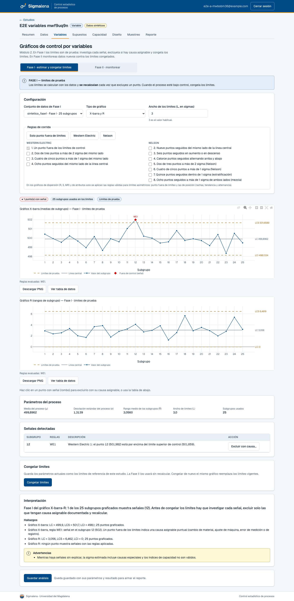

Requiere al menos un conjunto de datos de variables guardado.

1. Elegir la pestaña **Fase I · estimar y congelar límites** o **Fase II · monitorear**. Cada una muestra un cuadro de color que indica en qué fase se está.
2. En **Configuración**:
   - **Conjunto de datos de Fase I (o II)**.
   - **Tipo de gráfico:** X-barra y R, X-barra y S, o I-MR. El programa propone I-MR si todos los subgrupos tienen una sola observación y X-barra y R en los demás casos. X-barra necesita subgrupos del mismo tamaño; I-MR necesita observaciones individuales; si no coinciden, el programa lo advierte.
   - **Ancho de los límites (L, en sigmas):** 3 por defecto. En Fase II se usa el L congelado.
   - **Reglas de corrida:** los botones **Solo punto fuera de límites**, **Western Electric** y **Nelson** activan conjuntos de reglas; también se marcan una a una. La regla de un punto fuera de los límites está siempre activa.
   - **Reglas omitidas por panel.** No todas las reglas son válidas en todos los paneles, y el programa lo dice. Bajo cada gráfico, la línea «Reglas evaluadas» lista las que se aplicaron y, si hay reglas pedidas que no se evaluaron, aparece «Reglas pedidas que no se evaluaron en este gráfico» con el motivo de cada una. Las reglas de zonas (WE2, WE3, N5 a N8) suponen que la distribución del estadístico graficado es simétrica respecto de la línea central; en los paneles R, S y en los de atributos con límite inferior truncado no lo es, y se omiten. En el panel de **rango móvil (MR)** solo se evalúa el punto fuera de límites, porque dos rangos móviles consecutivos comparten una observación y están correlacionados. En R, S y atributos, las reglas de racha (WE4, N2 a N4) sí se aplican, pero para WE4 y N2 la **Interpretación** agrega una advertencia, y una señal de esas reglas es un indicio por confirmar, no una prueba. El sentido de la advertencia depende del panel: en R y S la tasa de falsas alarmas es mayor que la nominal; en los gráficos de conteos es distinta de la nominal y puede ser mucho menor si la línea central coincide con un conteo posible (los puntos iguales a ella cortan la racha), con pérdida de sensibilidad.
   - **Varias reglas a la vez.** Cuando se activan varias reglas, el programa advierte que la tasa de falsa alarma conjunta sube: con un estadístico normal y el proceso en control, un punto fuera de límites da una falsa alarma cada 370 puntos en promedio (ARL0 = 370), las cuatro reglas de Western Electric juntas cada 92 y las doce reglas cada 66 aproximadamente. Una señal aislada de una regla suplementaria puede ser una falsa alarma; el ARL0 exacto de la combinación elegida se calcula en el módulo de Diseño.
3. El gráfico muestra la línea central, los límites, los puntos con señal (rombo) y los excluidos (cruz). El valor y la regla aparecen al pasar el cursor sobre un punto.
4. Debajo se leen los **Parámetros del proceso** y la tabla **Señales detectadas**, con el subgrupo, la regla y su descripción.

**Depurar y congelar en Fase I.**

1. Haz clic en un punto con señal, o pulsa **Excluir con causa…** en la tabla.
2. Se abre «Excluir punto del cálculo de límites». Escribe la **causa asignable** (obligatoria) y pulsa **Excluir y recalcular**. Excluye solo si identificaste algo concreto que ocurrió.
3. Los límites se recalculan sin ese punto. El punto sigue visible en el gráfico. La tabla **Puntos excluidos** lista cada causa y permite **Restaurar**.
4. Cuando no queden señales sin explicar, pulsa **Congelar límites** y confirma en la ventana. Si todavía hay señales, la ventana lo advierte. Congelar de nuevo el mismo tipo de gráfico reemplaza los límites vigentes.

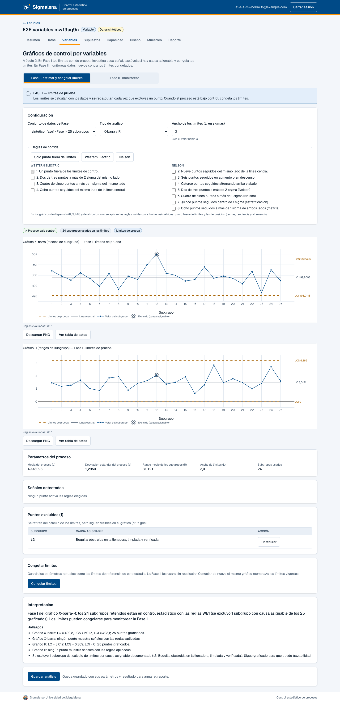

La captura anterior muestra la Fase I después de excluir el subgrupo 12: la tabla **Puntos excluidos** conserva la causa y el gráfico sigue mostrando el punto.

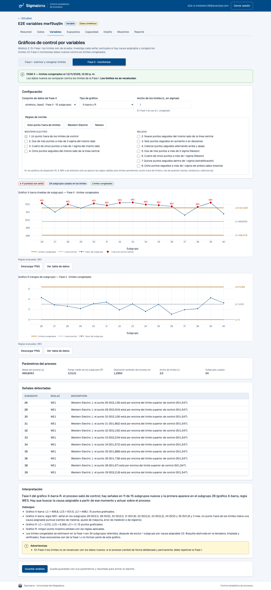

**Monitorear en Fase II.** Cambiar a **Fase II**. Si no hay límites congelados del tipo de gráfico elegido, el programa lo dice y no calcula. Con límites congelados, los datos se comparan contra ellos y **no se recalculan**. En Fase II no se excluyen puntos.

**Uso en teléfono.** Los gráficos se adaptan a pantallas angostas: en un teléfono de 390 px de ancho el gráfico cabe en pantalla y la página no se desplaza en horizontal.

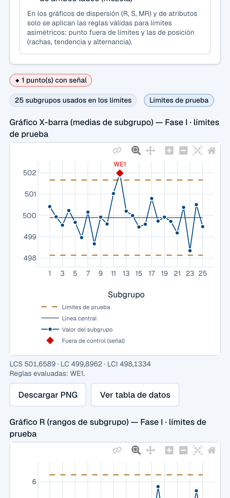

**Guardar el análisis.** Al final, **Guardar análisis** pide un título y la casilla **Incluir en el reporte**; confirmar con **Confirmar y guardar**.

### 5.5 Módulo 3: Gráficos de control por atributos

Disponible en estudios de tipo Atributo, con el mismo esquema de Fase I y Fase II que las variables (pestañas **Fase I · estimar y congelar límites** y **Fase II · monitorear**, ancho de límites, reglas de corrida, exclusión con causa, congelar límites y guardar el análisis).

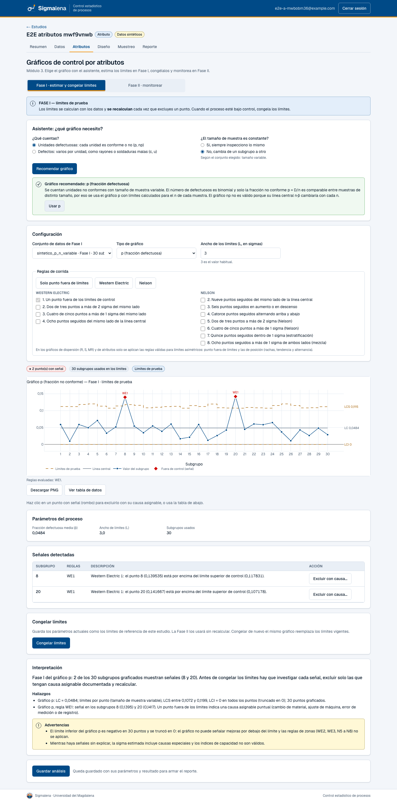

La captura muestra el gráfico p con `sintetico_p_n_variable`. El gráfico se construye así:

1. Cargar y guardar el conjunto en **Datos** (qué se cuenta, columna del conteo y columna del tamaño de muestra).
2. En **Atributos**, usar el **Asistente: ¿qué gráfico necesito?**: responder **¿Qué cuentas?** (unidades defectuosas, o defectos por unidad) y **¿El tamaño de muestra es constante?**, y pulsar **Recomendar gráfico**. El programa responde con el gráfico (p, np, c o u), una justificación y alternativas, y el botón **Usar** lo selecciona. En la captura recomienda p porque el tamaño varía y explica por qué np no es válido.
3. En **Configuración** elegir el conjunto de datos, el **Tipo de gráfico** y el ancho de límites (3 por defecto).
4. Leer el gráfico (límites escalonados cuando el tamaño cambia de una muestra a otra), los **Parámetros del proceso** (fracción defectuosa media, ancho de límites y subgrupos usados), las **Señales detectadas** y la **Interpretación**. Para excluir una muestra con causa asignable, pulsar **Excluir con causa…** en la fila de la señal.
5. Cuando no queden señales sin explicar, **Congelar límites**; en Fase II se vigila contra ellos.

Reglas de selección que aplica el asistente:

| Qué se cuenta | Tamaño de muestra | Gráfico |
|---|---|---|
| Unidades defectuosas | Variable | p |
| Unidades defectuosas | Constante | np (alternativa: p) |
| Defectos por unidad | Constante | c (alternativa: u) |
| Defectos por unidad | Variable | u |

El gráfico np exige tamaño constante. En los gráficos de atributos el límite inferior se trunca en 0 cuando saldría negativo, y por eso el gráfico **no puede señalar mejoras** por debajo del límite: la advertencia de la captura lo dice. Con límite truncado se omiten las reglas de zonas y, si se activan las de racha, la interpretación avisa de que su tasa de falsas alarmas es distinta de la nominal y puede ser mucho menor cuando la línea central coincide con un conteo posible (sección 5.4).

### 5.6 Módulo 4: Supuestos

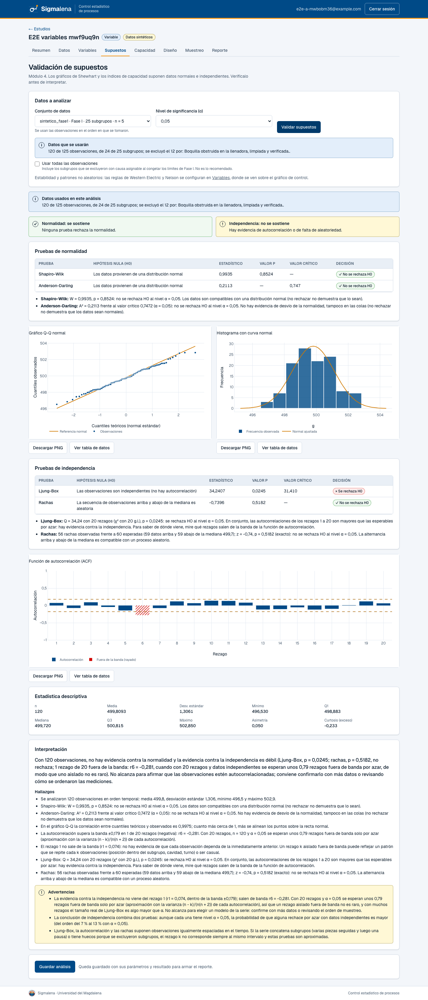

Solo para estudios por variables.

La captura muestra el conjunto depurado de Fase I (120 de 125 observaciones, de 24 de 25 subgrupos): el recuadro «Datos que se usarán», la casilla «Usar todas las observaciones», las pruebas de normalidad y de independencia, el Q-Q, el histograma, la ACF y la interpretación con evidencia débil contra la independencia (ejemplo B, sección 8). Obsérvese que el cuadro resumen superior rotula la independencia con una etiqueta binaria («no se sostiene») porque Ljung-Box rechaza, mientras que la **Interpretación** gradúa la evidencia y la califica de débil; la segunda es la lectura que debe usarse.

1. Elegir el **Conjunto de datos** y el **Nivel de significancia (α)**: 0,10, 0,05 o 0,01. Las observaciones se usan en el orden en que se tomaron.
2. Revisar el recuadro **Datos que se usarán**. Si el conjunto es de Fase I y ya se congelaron límites con él, **por defecto se usan solo las observaciones de los subgrupos retenidos** (por ejemplo, «120 de 125 observaciones, de 24 de 25 subgrupos; se excluyó el 12 por: …»), para que el análisis describa los mismos datos con que se estimaron los límites. Si se quiere incluir los subgrupos excluidos, marcar la casilla **Usar todas las observaciones** (no es lo recomendado). Sin límites congelados, se usan todas.
3. Pulsar **Validar supuestos**. Arriba de los resultados aparece **Datos usados en este análisis**, que repite qué observaciones se analizaron.
3. Aparecen dos cuadros resumen («Normalidad: se sostiene o no» e «Independencia: se sostiene o no»), las tablas de **Pruebas de normalidad** (Shapiro-Wilk y Anderson-Darling) y de **Pruebas de independencia** (Ljung-Box y rachas), con el estadístico, el valor p y si se rechaza H0; el **Gráfico Q-Q normal**, el **Histograma con curva normal**, la **Función de autocorrelación (ACF)** y la **Estadística descriptiva**. En la ACF, las barras que salen de la banda ±z/√n se marcan rayadas; el programa informa cuántos rezagos se esperan fuera de banda solo por azar (unos 0,79 con 20 rezagos y n = 120), de modo que un rezago aislado fuera de banda no es raro.
4. La **Interpretación** y las **Advertencias** explican qué hacer si algún supuesto falla. Están redactadas con cautela: no rechazar una prueba no demuestra el supuesto, y un rechazo aislado se presenta como evidencia débil cuando solo un rezago sale de la banda y la otra prueba no rechaza.
5. **Guardar análisis** deja el resultado disponible para el reporte y para el módulo de Capacidad, que lo usa para saber si los datos son normales.

Los patrones no aleatorios en un gráfico de control se ven con las reglas de corrida del módulo 2.

### 5.7 Módulo 5: Capacidad

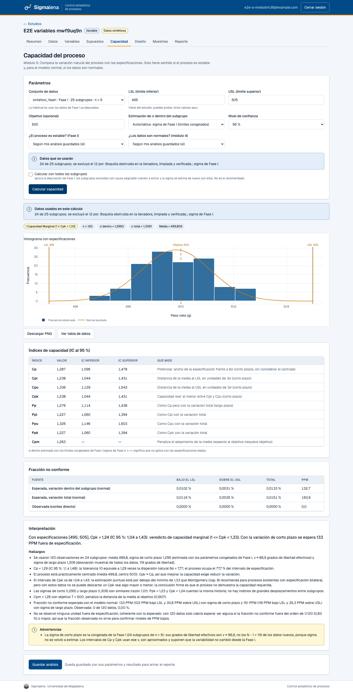

Solo para estudios por variables.

1. Elegir el **Conjunto de datos** (lo habitual es la Fase I ya depurada).
2. Leer el recuadro **Datos que se usarán**. Si los límites congelados vigentes salen de este conjunto, **por defecto se usan los subgrupos retenidos de Fase I y la sigma de corto plazo congelada** (por ejemplo, «24 de 25 subgrupos; se excluyó el 12 por: …; sigma de Fase I»). Así los índices describen el proceso ya depurado y estable. La casilla **Calcular con todos los subgrupos** ignora esa depuración: los subgrupos excluidos con causa asignable vuelven a entrar y la sigma se estima de nuevo con ellos. No es lo recomendado. Sin límites congelados de ese conjunto, se usan todos los subgrupos.
3. Revisar **LSL**, **USL** y **Objetivo** (vienen del estudio y se pueden cambiar aquí).
4. Elegir la **Estimación de σ dentro del subgrupo:** automática (con depuración activa, la sigma de Fase I; si no, R-barra/d2 o S-barra/c4 según el tamaño de subgrupo), R-barra/d2, S-barra/c4, rango móvil/d2 o **Límites congelados de Fase I** (habilitada solo si hay límites congelados).
5. Elegir el **Nivel de confianza** (90, 95 o 99 %).
6. En **¿El proceso es estable? (Fase I)** y **¿Los datos son normales? (módulo 4)**, la opción por defecto es «Según mis análisis guardados» y muestra entre paréntesis lo que encontró (sí, no o sin dato). La estabilidad sale del análisis de control guardado **para esos mismos datos** (mismo conjunto, misma fase y mismas exclusiones); la normalidad, del análisis de supuestos guardado **sobre las mismas observaciones**. También se puede responder Sí, No o «No lo sé».
7. Pulsar **Calcular capacidad**.

Se obtienen: un veredicto (inadecuada, marginal, adecuada o excelente), la media y las dos sigmas, el recuadro **Datos usados en este cálculo**, el histograma con las especificaciones, la tabla de **Índices de capacidad** con su intervalo de confianza, el cuadro de **Fracción no conforme** y la interpretación.

**Advertencias antes de interpretar.** Si no se pudo confirmar la estabilidad o la normalidad, aparece el recuadro «Antes de interpretar estos índices». Si dice «No se verificó la estabilidad: no hay un análisis de control guardado para estos mismos datos», hay que ir a **Variables**, correr el gráfico de Fase I con las mismas exclusiones y pulsar **Guardar análisis**. Si dice «No se verificó la normalidad: no hay un análisis de Supuestos guardado sobre estas mismas observaciones», hay que correr y guardar el módulo **Supuestos** con los mismos datos. Los intervalos de Cp y Cpk con la sigma congelada o con R-barra/d2 son **aproximados** (la interpretación informa los grados de libertad efectivos usados, por ejemplo ν ≈ 86,9 en lugar de 119) y son más anchos que con la desviación muestral.

La captura muestra el caso del ejemplo B: n = 120, σ dentro = 1,2950 (la de Fase I), Cp = 1,287, Cpk = 1,238 y capacidad marginal.

**Cómo se redacta la conclusión.** El programa solo afirma «con 95 % de confianza Cpk supera el mínimo» si la estabilidad del proceso está confirmada. Si el proceso no está en control (o no se informó), el resumen dice que no se puede declarar su capacidad, y los índices describen solo esos datos. Si el Cpk puntual alcanza el mínimo pero la cota inferior de confianza no, el resumen lo declara **no concluyente**: con esos datos no se puede afirmar con la confianza elegida que el proceso cumpla.

### 5.8 Módulo 6: Diseño de gráficos

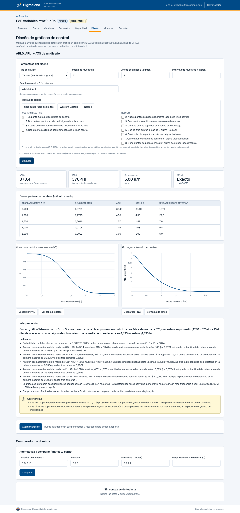

Tiene dos bloques.

**ARL0, ARL1 y ATS de un diseño.**
1. Elegir el **Tipo de gráfico:** X-barra, Individuales (I), p o c.
2. Escribir **Tamaño de muestra n**, **Ancho de límites L** e **Intervalo de muestreo h (horas)**. Con p, también **p0**; con c, **c0**.
3. Escribir los desplazamientos a evaluar (en sigmas para X-barra e individuales; fracciones p1 o medias c1 para p y c), separados por espacios o punto y coma, con punto decimal.
4. Opcionalmente elegir reglas adicionales (solo X-barra e individuales). Con la regla de un punto sola, el cálculo es **exacto**; con reglas adicionales, el programa **simula** y pide **Corridas de simulación**.
5. Pulsar **Calcular**. Resultado: ARL0, ATS0, carga muestral (unidades por hora), una tabla de desempeño por desplazamiento (β, ARL1, ATS1, unidades hasta detectar), la **Curva característica de operación (OC)** y la curva **ARL según el tamaño del cambio**.

**Alternativas a comparar (gráfico X-barra).** Escribir listas de **Tamaños de muestra n**, **Anchos L**, **Intervalos h (horas)** y el **Desplazamiento a detectar (σ)**, y pulsar **Comparar**. Se obtiene una tabla de diseños y el gráfico «Detección frente a carga de inspección». Si una lista contiene algo que no es un número positivo, el programa muestra el aviso «Revisa las listas: solo números positivos separados por espacios o punto y coma» junto al formulario y conserva la tabla calculada antes.

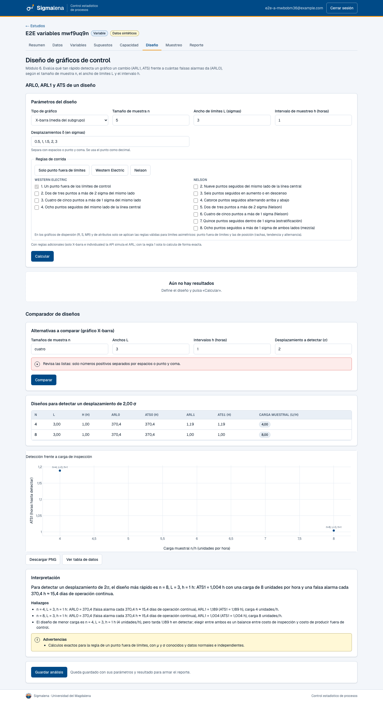

La captura muestra el aviso (se escribió «cuatro» en el tamaño de muestra) y, debajo, la comparación previa de n = 4 y n = 8, con L = 3 y h = 1 h, para un desplazamiento de 2σ.

### 5.9 Módulo 7: Muestreo de aceptación

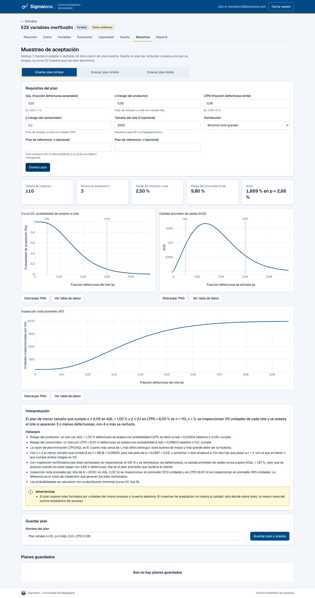

La pestaña **Muestreo** tiene tres pestañas internas.

| Pestaña | Para qué |
|---|---|
| **Diseñar plan simple** | Buscar el plan (n, c) más pequeño que cumple AQL, α, LTPD y β |
| **Evaluar plan simple** | Calcular los riesgos reales de un plan (n, c) que ya se tiene |
| **Evaluar plan doble** | Evaluar un plan doble (n1, c1, r1, n2, c2) |

En **Diseñar plan simple** se escriben **AQL**, **α**, **LTPD**, **β**, el **Tamaño del lote N** (opcional; necesario para la inspección total promedio y la distribución hipergeométrica), la **Distribución** (binomial, Poisson o hipergeométrica) y, opcionalmente, un **plan de referencia** (n y c de una tabla o nomograma) para compararlo. Se pulsa **Diseñar plan**. Las fracciones se escriben como decimales: 0,01 es 1 %.

La respuesta trae n, c, el α y el β reales, las curvas OC, AOQ y ATI, el AOQL (límite de calidad promedio de salida) y la interpretación. El botón de guardado crea el plan y lo añade al reporte. Los planes guardados aparecen en una lista con la opción **Eliminar**.

### 5.10 Módulo 8: Reporte


1. En cada módulo, guardar los análisis que importan con **Guardar análisis**.
2. En **Reporte**, la tabla **Análisis guardados** lista cada uno con la casilla **Incluir** y la acción **Eliminar**.
3. El documento reúne los análisis incluidos, ordenados por módulo, con tablas y figuras numeradas y la interpretación de cada uno.
4. **Imprimir / guardar PDF** abre el diálogo de impresión del navegador; elegir «Guardar como PDF».
5. **Exportar a Excel** descarga un archivo `.xlsx` con los resultados.

## 6. Formato de entrada de datos

Lo que sigue vale para archivos y también para la tabla de ingreso manual (sección 5.3.1), con una diferencia: en la tabla se acepta la coma decimal y las filas vacías se omiten.

Archivo **CSV** (UTF-8, separador coma, punto decimal) o **Excel (.xlsx)** con una hoja, sin celdas combinadas ni filas de totales. La primera fila lleva los encabezados, en minúsculas y sin espacios. Una fila por subgrupo (formato ancho) o por observación (formato largo). Las fechas, en formato `AAAA-MM-DD`. Las celdas sin medir, vacías (no `N/D` ni `0`).

**Variables, formato ancho (X-barra-R, X-barra-S):**

| fecha | turno | subgrupo | x1 | x2 | x3 | x4 | x5 |
|---|---|---|---|---|---|---|---|
| 2026-03-02 | Mañana | 1 | 500.83 | 499.72 | 499.92 | 499.35 | 502.26 |
| 2026-03-02 | Tarde | 2 | 500.08 | 501.34 | 499.51 | 499.78 | 498.97 |

Todas las filas deben tener el mismo número de columnas `x` para X-barra.

**Individuales (I-MR):** columnas `fecha`, `turno`, `subgrupo` y una sola columna `valor`.

**Atributos:**

| Gráfico | Columnas |
|---|---|
| p (n variable) y np (n constante) | `fecha`, `turno`, `subgrupo`, `defectuosos`, `tamano_muestra` |
| c | `fecha`, `turno`, `subgrupo`, `defectos` |
| u | `fecha`, `turno`, `subgrupo`, `defectos`, `unidades_inspeccion` |

`defectuosos` cuenta unidades con al menos un defecto (p, np). `defectos` cuenta los defectos (c, u).

Qué hace el programa con lo que se aparta del formato (comprobado con `sintetico_sucio.csv`):

| Situación | Resultado |
|---|---|
| Celda vacía en una columna numérica | Se cuenta como faltante en «Columnas detectadas», aparece en «Avisos al leer el archivo» y el subgrupo queda con menos observaciones |
| Texto como `N/D` en una columna numérica | Se trata como faltante, con aviso |
| Coma decimal escrita como texto (`500,8`) | Se interpreta como 500,8, con aviso |
| Fecha escrita día/mes/año | Se normaliza a `AAAA-MM-DD`, con aviso |
| Valor absurdo (`5050.0`) | La tabla de atípicos lo marca; no se borra |
| Espacios alrededor de un texto (` Tarde `) | Se recortan, con aviso |
| Subgrupos con menos observaciones que los demás | Se listan como incompletos y se pueden retirar con justificación; no se rellenan |

Todos los avisos de la lectura pasan a la bitácora de limpieza al guardar el conjunto.

Para recolectar datos en la planta con este formato hay una plantilla en `docs/empresa/plantilla_recoleccion.xlsx` y su descripción en `docs/empresa/formato-recoleccion.md`.

## 7. Interpretación de las salidas

### 7.1 Gráficos de control

| Elemento | Cómo leerlo |
|---|---|
| Línea central | Nivel estimado del proceso (media de las medias, R-barra, p-barra, etc.) |
| LCS y LCI | Límites de control a L sigmas (3 por defecto). Se calculan con los datos del propio proceso, **no son especificaciones** |
| Rombo rojo | Punto con una señal de alguna regla activa |
| Cruz gris | Punto excluido del cálculo de límites en Fase I, con causa registrada |
| Panel R, S o MR | Variabilidad. Si hay señal aquí, interpretar el panel de la media con cautela: sus límites suponen una variabilidad estable. En I-MR, un rango móvil fuera de límites indica un salto grande entre dos observaciones consecutivas (dato atípico, error de registro o cambio de nivel), no necesariamente un cambio de la variabilidad |

**Fase I:** los límites son de prueba. Una señal es una invitación a investigar, no una sentencia. Se excluye solo con causa asignable documentada. **Fase II:** los límites están congelados; una señal significa que el proceso cambió respecto a la referencia.

Reglas de corrida disponibles: WE1 (un punto fuera de 3σ), WE2 (dos de tres puntos más allá de 2σ del mismo lado), WE3 (cuatro de cinco más allá de 1σ), WE4 (ocho seguidos de un mismo lado) y las de Nelson N1 a N8. Más reglas activas detectan antes los cambios pequeños, pero aumentan las falsas alarmas (módulo 6). Las reglas de zonas se omiten en los paneles R, S y de atributos con límite truncado; en el panel MR solo rige el punto fuera de límites; y las reglas de racha WE4 y N2 en R, S y atributos se aplican con una advertencia sobre su tasa de falsas alarmas, que es mayor que la nominal en R y S y distinta (posiblemente mucho menor) en conteos (sección 5.4). Con varias reglas activas la tasa de falsa alarma conjunta sube (ARL0 de 370 con un punto fuera de límites, cerca de 92 con las cuatro Western Electric y cerca de 66 con las doce).

### 7.2 Supuestos

| Prueba | H0 | Si se rechaza |
|---|---|---|
| Shapiro-Wilk y Anderson-Darling | Los datos son normales | Hay evidencia de que no son normales: los índices de capacidad y las PPM suponen normalidad y dejan de ser confiables |
| Ljung-Box y rachas | Las observaciones son independientes | Hay dependencia: los límites de Shewhart darían falsas alarmas |

Un valor p menor que α rechaza H0. Una prueba que no rechaza no demuestra que el supuesto sea cierto: solo que no hay evidencia en contra con esos datos. Con muchas pruebas y rezagos, algún rechazo aislado aparece por azar (con 20 rezagos y n = 120 se esperan unos 0,79 rezagos fuera de banda solo por azar, de modo que uno aislado no es raro); conviene mirar los gráficos y el contexto. Por eso el programa distingue «evidencia débil» (un rechazo marginal, un solo rezago fuera de banda, la otra prueba sin rechazar) de «evidencia de autocorrelación» (varios rezagos fuera de banda y ambas pruebas con rechazo).

### 7.3 Capacidad

| Índice | Mide | Referencia común |
|---|---|---|
| Cp | Tolerancia dividida por 6 sigmas de corto plazo; no mira el centrado | Mayor que 1,33 |
| Cpl y Cpu | Distancia de la media a cada límite en 3 sigmas | Mayores que 1,33 |
| Cpk | El menor de Cpl y Cpu; incluye el centrado | Menor que 1: inadecuada; 1 a 1,33: marginal; 1,33 a 1,67: adecuada; 1,67 o más: excelente |
| Pp y Ppk | Lo mismo con sigma de largo plazo (todos los datos) | Se comparan con Cp y Cpk: si difieren mucho hay desplazamientos entre subgrupos |
| Cpm | Penaliza la distancia a la media objetivo | Cpm menor que Cpk indica descentrado respecto al nominal |

Los intervalos de confianza dependen de cómo se estimó sigma: con la desviación muestral usan N - 1 grados de libertad; con R-barra/d2, S-barra/c4, rango móvil/d2 o la sigma congelada de Fase I usan los grados de libertad efectivos de ese estimador (menores que N - 1), y por eso son más anchos y se marcan como aproximados.

La **fracción no conforme esperada** (modelo normal, en proporción y en partes por millón) se compara con la **observada** (conteo directo). Con pocos datos, una fracción observada de cero no demuestra pocas PPM: el programa lo aclara. **Los índices solo tienen sentido si el proceso es estable.** El programa lo advierte cuando se indica o se detecta lo contrario.

### 7.4 ARL, ATS y carga muestral

| Sigla | Significado |
|---|---|
| ARL0 | Muestras promedio hasta una falsa alarma con el proceso en control. Mayor es mejor |
| ARL1 | Muestras promedio hasta detectar un cambio dado. Menor es mejor |
| ATS | ARL por el intervalo h entre muestras: tiempo en horas |
| β | Probabilidad de no detectar el cambio en una muestra |
| Carga muestral | Unidades inspeccionadas por hora, n/h |

Aumentar n o muestrear con más frecuencia acelera la detección pero cuesta más inspección. El comparador pone ambos lados a la vista. Los cálculos suponen parámetros conocidos, datos normales e independientes.

### 7.5 Muestreo de aceptación

La curva OC da la probabilidad de aceptar un lote según su fracción defectuosa. α es el riesgo de rechazar un lote bueno (en el AQL) y β el de aceptar uno malo (en el LTPD). El AOQL es lo peor que recibiría el cliente en promedio con inspección rectificadora. El muestreo de aceptación decide sobre lotes; no mejora la calidad del proceso.

### 7.6 Interpretación automática

Cada análisis incluye una **Interpretación** con una conclusión, hallazgos y **Advertencias** en español. Son conclusiones preliminares para orientar la lectura; el juicio de ingeniería sobre el proceso sigue siendo de la persona que analiza.

## 8. Ejemplos de uso con los archivos de `data/ejemplos/`

Todos los archivos son sintéticos. El README de esa carpeta lista el resultado esperado de cada uno. Los números siguientes salen de `docs/informe/anexos/salidas/`.

### Ejemplo A: Fase I y Fase II de variables (`sintetico_fase1` y `sintetico_fase2`)

1. Crear un estudio por variables con LSL 495, USL 505 y objetivo 500, marcando «Datos sintéticos».
2. En **Datos**, cargar `sintetico_fase1.csv`. Elegir «Varias columnas por fila», marcar x1 a x5 y la etiqueta `subgrupo`. Justificación sugerida: «Cinco envases consecutivos del mismo turno y línea». Guardar como **Fase I**.
3. En **Variables**, Fase I, tipo X-barra y R, con la regla de un punto fuera de límites. Resultado: el subgrupo 12 (media 501,98 g) sale de los límites; LC = 499,896, LCS = 501,659, LCI = 498,133 y R-barra = 3,056.
4. Excluir el subgrupo 12 escribiendo una causa (en este ejemplo ficticio, «boquilla obstruida»). Los límites pasan a LC = 499,809, LCS = 501,547 y LCI = 498,072, con R-barra = 3,012 y 24 subgrupos usados. Pulsar **Congelar límites** y, en **Guardar análisis**, guardar el análisis (lo necesita Capacidad para saber que el proceso es estable).
5. En **Datos**, cargar `sintetico_fase2.csv` y guardarlo como **Fase II**.
6. En **Variables**, pestaña Fase II. Resultado: 11 de 15 subgrupos con señal (26, 28, 30 a 36, 38 y 39); el gráfico R no tiene señales.

### Ejemplo B: supuestos y capacidad (con el mismo conjunto de Fase I)

1. En **Supuestos**, con el conjunto de Fase I (el recuadro «Datos que se usarán» dice 120 de 125 observaciones, de 24 de 25 subgrupos) y α = 0,05. Resultado: Shapiro-Wilk W = 0,9935 (p = 0,8524) y Anderson-Darling (A² = 0,2113 frente al valor crítico 0,7472) no rechazan la normalidad; Ljung-Box Q = 34,24 (p = 0,0245) rechaza la independencia, mientras que la prueba de rachas (p = 0,5182) no. Solo el rezago 6 sale de la banda de la ACF (r = -0,281, banda ±0,179). El programa lo presenta como evidencia débil contra la independencia y no como autocorrelación demostrada; el informe técnico lo discute. Guardar el análisis.
2. En **Capacidad**, con el mismo conjunto: el recuadro «Datos que se usarán» dice 24 de 25 subgrupos con la sigma de Fase I, y los menús de estabilidad y normalidad leen «Según mis análisis guardados (sí)». Resultado: n = 120, sigma dentro 1,2950, Cp = 1,287 (IC 95 %: 1,096 a 1,478), Cpk = 1,238 (IC 95 %: 1,044 a 1,431), veredicto «marginal», 133 PPM esperadas con sigma de corto plazo. La advertencia de la interpretación informa que los intervalos usan ν ≈ 86,9 grados de libertad efectivos.

### Ejemplo C: gráfico p con tamaño de muestra variable (`sintetico_p_n_variable`)

En un estudio de tipo **Atributo**, cargar el archivo con «Qué cuentas: Unidades defectuosas», conteo `defectuosos` y tamaño `tamano_muestra`. En **Atributos**, el asistente recomienda **p** porque el tamaño varía. Resultado de Fase I: p-barra = 0,0484 y señales en las muestras 8 y 20 (límites distintos en cada muestra).

### Ejemplo D: datos con problemas (`sintetico_sucio`)

Cargar el archivo. La tabla de columnas detectadas muestra faltantes en `turno`, `x1`, `x2` y `x4`, y el recuadro **Avisos al leer el archivo (8)** lista las conversiones: una fecha día/mes/año normalizada, espacios recortados, un `N/D` tratado como faltante, dos celdas vacías y dos comas decimales convertidas a punto. Se forman 20 subgrupos con 97 observaciones. En el resumen, el valor 5050 del subgrupo 9 (posición 5) aparece en **Atípicos marcados**: es un decimal mal capturado en este archivo construido a propósito. Decidir **Retirar el subgrupo completo** con la justificación correspondiente. Los subgrupos 3, 7 y 11 quedan con 4 observaciones: aparecen en **Subgrupos incompletos (3)** y se pueden retirar con **Retirar todos…** y una justificación (por ejemplo, «celdas vacías en el archivo original»); si no se retiran, X-barra avisará que necesita subgrupos del mismo tamaño. Al guardar, la bitácora queda con los avisos, la decisión sobre el atípico y los subgrupos retirados.

### Ejemplo E: datos no normales y autocorrelados

- `sintetico_no_normal`: en **Supuestos** se rechaza la normalidad (Shapiro-Wilk W = 0,8873 con p menor que 0,0001; asimetría 1,57) y no hay evidencia contra la independencia. El programa advierte que los índices de capacidad no son confiables y que, antes de transformar los datos, hay que confirmar que el proceso esté en control.
- `sintetico_autocorrelado`: la autocorrelación de rezago 1 es 0,703 (7 de 15 rezagos fuera de banda), Ljung-Box rechaza (p menor que 0,0001), rachas también (p = 0,0003) y el programa advierte que los límites de Shewhart darían falsas alarmas.

### Ejemplo F: individuales (`sintetico_i_mr`)

Cargar con «Una columna con los valores», columna `valor` y «Por tamaño fijo» con n = 1. En **Variables** elegir I-MR. Resultado: MR-barra = 1,672 y solo el rango móvil de la observación 16 sale fuera de límites; ningún individual sale. La tendencia que empieza en la observación 46 no la detecta la regla de un punto. La interpretación describe esa señal como «un salto grande entre dos observaciones consecutivas: un dato atípico, un error de registro o un cambio de nivel» y aclara que «un rango móvil grande aislado no demuestra que haya cambiado la variabilidad del proceso».

### Ejemplo G: diseño y muestreo

- **Diseño:** X-barra, n = 5, L = 3, h = 8 h. ARL0 = 370,4 y ATS0 = 2 963 h. Un desplazamiento de 1,5 sigmas se detecta en 1,566 muestras (12,5 h). Con las reglas de Western Electric, el programa simula y ARL0 baja a 91,5.
- **Muestreo:** AQL = 0,01, α = 0,05, LTPD = 0,06, β = 0,10, lote de 2 000, binomial. Plan resultante: n = 110 y c = 3, con α real 0,025 y β real 0,098.

## 9. Errores frecuentes y su solución

| Mensaje o síntoma | Causa probable | Qué hacer |
|---|---|---|
| «Falta configurar el acceso» | No hay variables de Supabase ni modo de demostración | Completar `web/.env.local` (sección 3) y reiniciar `npm run dev` |
| «El acceso como invitado no está habilitado en este proyecto» al pulsar **Continuar como invitado** | El proyecto de Supabase tiene desactivados los inicios de sesión anónimos | Crear una cuenta o iniciar sesión con correo; quien administre el proyecto debe activar *Anonymous sign-ins* en Authentication (el `README.md` lo explica; `docs/despliegue.md` aún no lo menciona) |
| Al volver a entrar ya no están mis estudios de invitado | Se cerró la sesión de invitado, se borraron los datos del sitio o se cambió de navegador: un invitado no puede volver a entrar | Antes de salir, usar **Crear cuenta para conservar mis datos**. Los datos de una sesión de invitado perdida no se pueden recuperar |
| «El máximo en esta tabla es 2000 filas» o «50 columnas» | Se llegó al tope de la tabla de ingreso manual | Subir un archivo (hasta 20 000 filas) |
| «Escribe o pega al menos una fila de datos para continuar» | La tabla de ingreso manual no tiene filas con datos | Escribir o pegar valores; las filas vacías no cuentan |
| Los pasos 2 a 4 no reflejan lo que acabo de cambiar en la tabla | Se editó la tabla después de pulsar **Usar estos datos** | Volver a pulsar **Usar estos datos** |
| «No se pudo leer el archivo» | Formato no soportado, archivo de más de 4 MB o de más de 20 000 filas | Guardar como CSV UTF-8 o `.xlsx`, una sola hoja; reducir el tamaño |
| Error 401 o sesión que se pierde | Sesión vencida o `SUPABASE_URL` mal puesta en la API | Cerrar sesión y volver a entrar; revisar la configuración (`docs/despliegue.md`) |
| La web no encuentra la API (error 404 en `/api/...`) | `API_URL` vacía o la API no está encendida | Encender la API y poner `API_URL=http://localhost:8000` en `.env.local` |
| «Falta la justificación del subgrupo racional» | El texto tiene menos de 10 caracteres | Explicar por qué esas observaciones forman un subgrupo |
| «Se necesitan al menos 2 subgrupos para guardar» | Configuración de columnas incorrecta | Revisar el formato de los datos y las columnas elegidas |
| «X-barra necesita subgrupos del mismo tamaño» | Hay subgrupos con celdas vacías o con otro número de observaciones (se ve en la tabla «Resumen por subgrupo», columna N) | En **Datos**, tarjeta **Subgrupos incompletos**: **Retirar…** (o **Retirar todos…**) con justificación, o completar los datos en el archivo original y volver a cargarlo, o usar I-MR si los datos son individuales. El programa nunca rellena valores faltantes |
| «Este conjunto son observaciones individuales (n = 1)» | Se eligió X-barra con datos individuales | Elegir I-MR |
| «El gráfico np exige tamaño de muestra constante» | n variable | Elegir p |
| «Sin límites congelados para este gráfico» (Fase II) | Falta congelar en Fase I, o se congeló otro tipo de gráfico | Ir a Fase I, depurar y pulsar **Congelar límites** |
| No se puede excluir un punto | Falta la causa asignable | Describir qué ocurrió; sin causa no se excluye |
| Fase II con muchas señales | El proceso cambió, o los límites de Fase I eran de un proceso inestable | Investigar el cambio; si fue deliberado y permanente, repetir la Fase I |
| «Indica al menos una especificación» (Capacidad) | LSL y USL vacíos | Completarlos en el estudio o en la pantalla |
| Advertencia de proceso no estable en Capacidad | Hay señales sin explicar | Resolver la inestabilidad antes de interpretar Cp y Cpk |
| «No se verificó la estabilidad: no hay un análisis de control guardado para estos mismos datos» (Capacidad) | No se guardó el análisis de Variables con las mismas exclusiones, o se cambió el conjunto o las exclusiones después de guardarlo | Correr el gráfico en **Variables** con las mismas exclusiones y pulsar **Guardar análisis**; o responder Sí/No en el menú, bajo la responsabilidad de quien analiza |
| «No se verificó la normalidad: no hay un análisis de Supuestos guardado sobre estas mismas observaciones» (Capacidad) | No se guardó Supuestos, o se guardó con otro número de observaciones (por ejemplo, con todos los subgrupos en lugar de los retenidos) | Correr **Supuestos** con los mismos datos (revisar «Datos que se usarán») y guardar el análisis |
| Capacidad da otros valores que el ejemplo B | Está marcada **Calcular con todos los subgrupos** o no se congelaron límites con ese conjunto, por lo que no se usa la depuración | Congelar los límites en Fase I y dejar la casilla desmarcada |
| «Reglas pedidas que no se evaluaron en este gráfico» | La regla pedida no es válida en ese panel (zonas en R, S, atributos truncados; todo salvo el punto fuera de límites en MR) | No es un error: leer el motivo. Para vigilar la variabilidad, usar la regla de un punto fuera de límites |
| La simulación tarda o falla por tiempo | Demasiadas corridas | Bajar las **Corridas de simulación** |
| Mensaje de error de la API | Datos inválidos o insuficientes (código 422) | Leer el mensaje en español: indica qué falta |
| La tabla de estudios sale vacía con sesión iniciada | Datos de otro usuario o política RLS mal aplicada | Verificar el usuario; revisar las migraciones (`docs/despliegue.md`) |
| El correo de confirmación lleva a `localhost` | *Site URL* sin actualizar en Supabase | Ajustarla (ver `docs/despliegue.md`, paso 1.4) |

## 10. Glosario técnico

| Término | Definición |
|---|---|
| AOQ y AOQL | Calidad promedio de salida con inspección rectificadora, y su máximo |
| AQL | Nivel de calidad aceptable: fracción defectuosa que el plan debe aceptar casi siempre |
| ARL0 y ARL1 | Longitud promedio de corrida: muestras hasta una falsa alarma (proceso en control) o hasta detectar un cambio dado |
| ATI | Inspección total promedio por lote |
| ATS | Tiempo promedio hasta la señal: ARL por el intervalo de muestreo |
| α | En gráficos, probabilidad de falsa alarma por muestra; en muestreo, riesgo del productor |
| β | En gráficos, probabilidad de no detectar un cambio en una muestra; en muestreo, riesgo del consumidor |
| Atributo | Dato de conteo: unidades defectuosas o defectos |
| Autocorrelación | Dependencia entre observaciones consecutivas |
| Capacidad (Cp, Cpk) | Comparación entre la variación natural del proceso y las especificaciones |
| Causa asignable (especial) | Factor concreto, ajeno al comportamiento habitual, que desplaza o dispersa el proceso |
| Causa común | Variación inherente al proceso estable |
| Congelar límites | Guardar los parámetros de Fase I para usarlos sin recalcular en Fase II |
| Fase I | Análisis retrospectivo: se depuran los datos y se estiman los límites |
| Fase II | Monitoreo prospectivo contra límites congelados |
| Fracción no conforme | Proporción de unidades fuera de especificación |
| LCS y LCI | Límites de control superior e inferior |
| LIE y LSE (LSL y USL) | Límites de especificación inferior y superior |
| LTPD | Fracción defectuosa límite que el plan debe rechazar casi siempre |
| Curva OC | Probabilidad de aceptar un lote según su fracción defectuosa |
| Rango móvil (MR) | Diferencia absoluta entre dos observaciones consecutivas |
| Regla de corrida | Patrón (Western Electric, Nelson) que señala comportamiento no aleatorio |
| Subgrupo racional | Observaciones tomadas en condiciones similares, de modo que la variación dentro del subgrupo sea solo de causa común |
| Valor p | Probabilidad, bajo H0, de un resultado tan extremo como el observado |

## 11. Contacto del equipo

> **POR COMPLETAR:** nombres de los integrantes, correo de contacto, programa académico y asignatura.

Docente de la asignatura: Manuel J. Campuzano Ph.D (según el enunciado).
